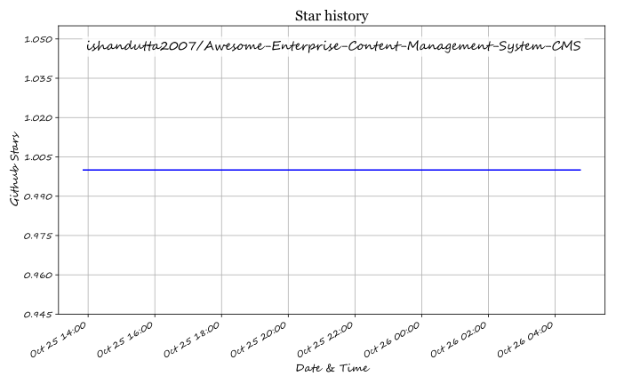

# Awesome-Enterprise-Content-Management-System-CMS

$repo_name = 'Awesome-Enterprise-Content-Management-System-CMS'
$repo_desc = 'Top Enterprise Content Management System CMS (Opensource) 🌟 Star if you like it! 🌟'

I want to create a similar GitHub's readme.md(i.e. strictly in markdown file format) for Top Enterprise Content Management System (CMS) like Adobe Experience Manager, Sitecore Experience Manager, Contentful, Contentstack, Drupal Enterprise, WordPress VIP, Bloomreach Content, Optimizely CMS, Acquia Cloud Platform, Crownpeak Digital Experience Platform and their equivalent open-source softwares. The format should be exactly same as you did this last time. Open-source softwares is what I'm primarily emphasizing on, so try to include as many open-sources as possible. But keep the 'SaaS/Hosted Platforms' section and 'Open-Source' Section separate. Remember, it must be in markdown format and response in markdown view as well, with a copy button on top right to copy the entire markdown.
You must give the entire response in English language

## Star History

<a href="https://star-history.com/#ishandutta2007/Awesome-Enterprise-Content-Management-System-CMS&Timeline" align="center">
  <picture>
    <source media="(prefers-color-scheme: dark)" srcset="assets/ishandutta2007_Awesome-Enterprise-Content-Management-System-CMS_growth.svg">
    
  </picture>
</a>
