# 🏛️ Awesome Enterprise Content Management Systems (CMS) & Composable DXP

  <strong>A curated directory of enterprise-grade Content Management Systems (CMS), Digital Experience Platforms (DXP), headless content engines, and self-hosted open-source solutions.</strong>

  
  
  
  
  
  
  

---

## 📑 Table of Contents

- [🔍 SEO & Architectural Overview Summary](#-seo--architectural-overview-summary)
- [📊 Sector Overview & Market Dynamics](#-sector-overview--market-dynamics)
- [☁️ Enterprise SaaS & Composable DXP Platforms](#️-enterprise-saas--composable-dxp-platforms)
- [🚀 Open-Source Enterprise CMS Solutions (Ranked by Stars)](#-open-source-enterprise-cms-solutions-ranked-by-stars)
  - [⚡ Headless & API-First CMS](#-headless--api-first-cms)
  - [🌐 Traditional & Hybrid Full-Stack CMS](#-traditional--hybrid-full-stack-cms)
  - [📄 Git-Based & Flat-File CMS](#-git-based--flat-file-cms)
- [🎯 Enterprise CMS Selection Decision Matrix](#-enterprise-cms-selection-decision-matrix)
- [🤝 How to Contribute](#-how-to-contribute)
- [💖 Support & Community](#-support--community)
- [📈 Star History](#--star-history)
- [⚖️ Disclaimer & License](#️-disclaimer--license)

---

## 🔍 SEO & Architectural Overview Summary

Welcome to the definitive, search-optimized index of **Enterprise Content Management Systems (CMS)**, **Digital Experience Platforms (DXP)**, and **Headless Content Hubs**. In modern enterprise digital engineering, content platforms serve as the single source of truth powering omnichannel web portals, mobile apps, customer portals, e-commerce storefronts, and IoT displays.

Whether you need a full-featured cloud SaaS suite with built-in personalization, or a highly extensible open-source headless CMS deployed on your own Kubernetes clusters, this guide provides factual technical and commercial data to guide your architecture decisions.

### 🏷️ Search Keywords
`enterprise cms`, `content management system`, `headless cms`, `composable dxp`, `digital experience platform`, `open source cms`, `strapi`, `payload cms`, `directus`, `adobe experience manager`, `sitecore xm cloud`, `contentful`, `wordpress vip`, `optimizely cms`, `wagtail`, `decap cms`, `ghost cms`, `enterprise content management`, `jamstack cms`, `graphql cms`, `decoupled cms`, `omnichannel content`.

---

## 📊 Sector Overview & Market Dynamics

The global **Enterprise Content Management (ECM)** and **Digital Experience Platform (DXP)** market is estimated at **$24.5 billion to $32.0 billion**, projected to grow at a compound annual growth rate (**CAGR of 11.8% to 14.5%**) toward **$58+ billion by 2030**, propelled by enterprise omnichannel digital transformations, cloud migrations, and generative AI content pipelines.

From a structural standpoint, the sector is **moderately fragmented with a dual-barbell dynamic rather than a winner-take-all monopoly**:
- **Enterprise Heavyweights (Traditional Monoliths & All-in-One Suites)**: Established giants like Adobe Experience Manager, Sitecore, and OpenText dominate the Global 2000 through multi-year contracts, integrated digital asset management (DAM), and complex governance workflows.
- **Composable & Headless Challengers**: Concurrently, modern API-first headless engines (such as Contentful, Strapi, Sanity, Payload CMS, and Storyblok) have captured rapid developer adoption and tech-forward enterprises by decoupling content repositories from presentation layers. This architectural shift prevents single-vendor lock-in and fosters intense continuous innovation across modular MACH (Microservices, API-first, Cloud-native, Headless) ecosystems.

---

## ☁️ Enterprise SaaS & Composable DXP Platforms

The following enterprise SaaS platforms provide managed hosting, global content delivery networks (CDNs), visual page editors, security compliance, and omnichannel delivery APIs.

> *Sorted descending by company valuation / market capitalization.*

| 🏢 Platform & Provider | 📈 Company Size (Valuation / Revenue) | 💳 Starting Tier Price | 🎁 Free Tier Limit / Free Trial Plan | ✨ Core Focus & Ecosystem Strengths |
| :--- | :--- | :--- | :--- | :--- |
| [**Adobe Experience Manager (AEM)**](https://business.adobe.com/products/experience-manager/adobe-experience-manager.html)   *(Adobe Inc. - NASDAQ: ADBE)* | **~$220 Billion** market cap   *($21.5B+ ARR)* | **$2,500.00 / month**   *(AEM Sites base tier, billed annually)* | **30-Day Free Sandbox Trial**: Full developer sandbox via Adobe Cloud Partner program with sample WKND sites and asset storage | The industry benchmark for Global 2000 enterprises; deep native synergy with Adobe Creative Cloud, Analytics, Target, and Sensei AI. |
| [**Optimizely CMS / DXP**](https://www.optimizely.com/products/content-management/)   *(Optimizely / Insight Partners)* | **~$9.0 Billion** valuation   *(~$400M ARR)* | **$1,600.00 / month**   *(Content Cloud base tier)* | **30-Day Free Evaluation Trial**: Full DXP cloud developer evaluation license with local runtime environment and sample foundation code | Hybrid headless DXP combining visual content composition, world-class experimentation, A/B multivariate testing, and personalized recommendations. |
| [**WordPress VIP**](https://wpvip.com/)   *(Automattic, Inc.)* | **~$7.5 Billion** valuation   *($300M+ ARR)* | **$2,000.00 / month**   *(Standard tier for single production application)* | **14-Day Guided Sandbox Trial**: Proof-of-concept cluster with automated code quality review bots, VIP CLI, and staging environment | Enterprise-grade WordPress hosting powering major high-traffic media brands (CNN, Time, Salesforce); FedRAMP security certified with autoscaling. |
| [**Sitecore XM Cloud**](https://www.sitecore.com/products/xm-cloud)   *(Sitecore / EQT Partners)* | **~$7.3 Billion** valuation   *($450M+ ARR)* | **$2,500.00 / month**   *(XM Cloud Starter subscription)* | **30-Day Free Cloud Sandbox**: XM Cloud developer environment with Sitecore Pages visual WYSIWYG editor and Next.js starter templates | Fully cloud-native composable CMS delivering sub-second edge content delivery, headless personalization, and omnichannel asset orchestration. |
| [**Contentful**](https://www.contentful.com/)   *(Contentful GmbH)* | **~$3.0 Billion** valuation   *($220M ARR)* | **$300.00 / month**   *(Basic plan for up to 20 users)* | **Free Forever (Community Plan)**: 1 space, up to 5 user seats, 25,000 total records, 2M API calls/mo, 50 GB asset bandwidth/mo | Market-defining composable content platform featuring structured JSON models, GraphQL/REST delivery APIs, and rich third-party App Marketplace. |
| [**Bloomreach Content**](https://www.bloomreach.com/en/products/content)   *(Bloomreach, Inc.)* | **~$2.2 Billion** valuation   *($150M+ ARR)* | **$1,250.00 / month**   *(Discovery & Content Starter tier)* | **30-Day Interactive Developer Sandbox**: Pre-indexed commerce and catalog sandbox with React/Vue connectors and merchandising simulations | Commerce-centric headless DXP engineered with built-in AI search, merchandising algorithms, and omnichannel digital storefront experiences. |
| [**Acquia Cloud Platform**](https://www.acquia.com/products/drupal-cloud)   *(Acquia Inc. / Vista Equity)* | **~$1.0 Billion** valuation   *($250M+ ARR)* | **$145.00 / month**   *(Cloud Professional starter tier)* | **30-Day Free Cloud Trial**: 1 development and 1 staging environment, Drush CLI integration, and automated pipeline tooling | Enterprise Drupal cloud founded by Drupal creator Dries Buytaert; specialized governance, multi-site management, and compliance for government/higher ed. |
| [**Contentstack**](https://www.contentstack.com/)   *(Contentstack, Inc.)* | **~$1.0 Billion** valuation   *($85M+ ARR)* | **$995.00 / month**   *(Growth plan)* | **14-Day Free Trial**: 1 full stack, unlimited content types, visual experience builder, and complete REST/GraphQL delivery API access | Founding member of MACH Alliance; enterprise headless CMS with modular extensions, visual assembly tools, and high-availability global CDN. |
| [**Sanity**](https://www.sanity.io/)   *(Sanity Operations, Inc.)* | **~$700 Million** valuation   *($45M+ ARR)* | **$15.00 / seat / month**   *(Growth plan)* | **Free Forever (Free Plan)**: Up to 20 user seats, 2 datasets, 500k API CDN requests/mo, 5 GB asset storage, 100 GB bandwidth | Structured content operating system with customizable open-source React studio, real-time multiplayer editing, and GROQ query engine. |
| [**Storyblok**](https://www.storyblok.com/)   *(Storyblok GmbH)* | **~$500 Million** valuation   *($30M+ ARR)* | **$99.00 / month**   *(Entry plan with 5 user seats included)* | **Free Forever (Community Plan)**: 1 seat, 1 space, visual editor with live real-time preview, 250 API calls/sec, 250 traffic units/mo | Headless CMS uniquely combining a visual component editor with live preview for marketers and clean APIs for modern front-end frameworks. |
| [**Crownpeak DXP**](https://www.crownpeak.com/)   *(Crownpeak / K1 Investment)* | **~$400 Million** valuation   *($75M ARR)* | **$1,500.00 / month**   *(Enterprise Cloud CMS entry tier)* | **14-Day Guided Cloud Sandbox**: Dedicated proof-of-concept tenant with digital accessibility governance and compliance scanning tools | Enterprise cloud-native headless CMS with integrated Digital Quality Management (DQM), accessibility audits, and consent management. |
| [**Kentico Xperience**](https://www.kentico.com/)   *(Kentico Software)* | **~$180 Million** valuation   *($35M ARR)* | **$1,400.00 / month**   *(Xperience by Kentico Base tier)* | **30-Day Full-Featured Cloud Trial**: Complete .NET core cloud instance with sample e-commerce journeys and marketing automation workflows | Modern hybrid headless DXP built on .NET, seamlessly combining content modeling, digital marketing, email campaigns, and customer analytics. |
| [**Hygraph**](https://hygraph.com/)   *(formerly GraphCMS)* | **~$150 Million** valuation   *($15M ARR)* | **$299.00 / month**   *(Professional plan with 3 environments)* | **Free Forever (Community Plan)**: 3 user seats, 1 environment, 100k API calls/mo, 100 content items, 5 GB asset storage | Native GraphQL-first headless CMS featuring powerful Content Federation to query, join, and serve remote backend systems via a unified API. |
| [**Magnolia CMS**](https://www.magnolia-cms.com/)   *(Magnolia International AG)* | **~$120 Million** valuation   *($25M ARR)* | **$1,800.00 / month**   *(Magnolia Cloud PaaS entry tier)* | **30-Day Cloud Trial**: Pre-configured authoring and public delivery instances, REST APIs, and personalization engine sandbox | Enterprise Java hybrid CMS trusted by global financial institutions and airlines; features visual SPA editing and composable microservices connectors. |
| [**Agility CMS**](https://agilitycms.com/)   *(Agility Inc.)* | **~$50 Million** valuation   *($10M ARR)* | **$1,200.00 / month**   *(Pro plan)* | **14-Day Free Trial**: Full access to page and sitemap management, content modeling, multi-site trees, and Next.js/Gatsby starter repos | Hybrid headless CMS bridging structured API content with intuitive page tree hierarchies and URL management for editorial teams. |

---

## 🚀 Open-Source Enterprise CMS Solutions (Ranked by Stars)

The following open-source CMS projects provide self-hostable, customizable architectures for full data ownership and enterprise compliance.

> *Sorted descending by exact GitHub stargazer count. Badges show live stars and link directly to stargazers.*

| 🏆 Rank | 📦 Repository & Name | ⭐ Live Stars (Social Badge) | 💻 Primary Stack | 🎯 Core Architectural Highlights |
| :---: | :--- | :---: | :--- | :--- |
| **1** | [**Strapi**](https://github.com/strapi/strapi) |  | TypeScript / Node.js | The leading open-source headless CMS; customizable admin panel, auto-generated REST/GraphQL APIs, and extensive plugin ecosystem. |
| **2** | [**Ghost**](https://github.com/TryGhost/Ghost) |  | JavaScript / Node.js | Modern publishing platform with native subscription commerce, newsletters, membership tiers, and ultra-clean REST APIs. |
| **3** | [**Payload CMS**](https://github.com/payloadcms/payload) |  | TypeScript / Next.js | Code-first headless CMS & application framework with native TypeScript types, React admin UI, Postgres/MongoDB, and local Node runtime. |
| **4** | [**Outline**](https://github.com/outline/outline) |  | TypeScript / React | Fast, collaborative enterprise team knowledge base and wiki with markdown support, fine-grained access control, and real-time collaboration. |
| **5** | [**Directus**](https://github.com/directus/directus) |  | TypeScript / Node.js | Real-time Open Data Platform wrapping any SQL database with instant REST and GraphQL APIs, visual dashboard, and granular permissions. |
| **6** | [**WordPress**](https://github.com/WordPress/WordPress) |  | PHP / MySQL | Powers over 40% of the top 10 million websites; massive plugin and theme ecosystem, Gutenberg block editor, and REST API. |
| **7** | [**Wagtail**](https://github.com/wagtail/wagtail) |  | Python / Django | Leading Python enterprise CMS; elegant StreamField content builder, Elasticsearch integration, fast workflows, and headless support. |
| **8** | [**Decap CMS**](https://github.com/decaporg/decap-cms) |  | JavaScript / React | Formerly Netlify CMS; single-page React app that acts as an open-source Git-based CMS for static site generators (Hugo, Astro, 11ty). |
| **9** | [**Grav**](https://github.com/getgrav/grav) |  | PHP / Flat-File | Award-winning open-source flat-file CMS; no database required, blazing fast performance, Twig templating, and markdown-based files. |
| **10** | [**TinaCMS**](https://github.com/tinacms/tinacms) |  | TypeScript / React | Git-backed headless CMS enabling real-time visual page editing directly on Next.js, Astro, and Remix sites with GraphQL schema. |
| **11** | [**django CMS**](https://github.com/django-cms/django-cms) |  | Python / Django | Enterprise-grade Python CMS with frontend drag-and-drop editing, multi-language support, versioning, and rigorous security architecture. |
| **12** | [**KeystoneJS**](https://github.com/keystonejs/keystone) |  | TypeScript / GraphQL | Powerful headless content platform with GraphQL schema definitions, customizable Next.js admin app, and session authentication. |
| **13** | [**Joomla!**](https://github.com/joomla/joomla-cms) |  | PHP / MySQL | Robust open-source enterprise CMS powering millions of websites; native multilingual support, granular ACL, and web services API. |
| **14** | [**ApostropheCMS**](https://github.com/apostrophecms/apostrophe) |  | JavaScript / Node.js | Full-stack JavaScript CMS built with Express and MongoDB; in-context visual page building, headless APIs, and localization. |
| **15** | [**Drupal**](https://github.com/drupal/drupal) |  | PHP / Symfony | Benchmark enterprise open-source CMS for universities, healthcare, and governments; modular taxonomy, JSON:API, and robust security. |
| **16** | [**Pimcore**](https://github.com/pimcore/pimcore) |  | PHP / Symfony | Enterprise open-source platform combining CMS, Product Information Management (PIM), Digital Asset Management (DAM), and Master Data (MDM). |
| **17** | [**Craft CMS**](https://github.com/craftcms/cms) |  | PHP / Yii | Flexible developer-friendly content platform with Matrix field builder, native GraphQL API, custom element types, and live preview. |
| **18** | [**Squidex**](https://github.com/Squidex/squidex) |  | C# / .NET Core | Enterprise open-source headless CMS and content hub built on .NET; event-sourcing architecture, MongoDB, GraphQL, and OData APIs. |
| **19** | [**Winter CMS**](https://github.com/wintercms/winter) |  | PHP / Laravel | Community-driven fork of OctoberCMS based on Laravel; combines flat-file page templates with database content models and AJAX framework. |
| **20** | [**TYPO3**](https://github.com/TYPO3/typo3) |  | PHP / Symfony | European enterprise powerhouse CMS; multi-site management, strict GDPR compliance, enterprise localization, and long-term support (LTS). |
| **21** | [**dotCMS**](https://github.com/dotCMS/core) |  | Java / Spring | Hybrid headless enterprise CMS built with Java; visual layout editor, multi-tenant site hierarchies, GraphQL, and OSGi plugins. |
| **22** | [**Concrete CMS**](https://github.com/concretecms/concretecms) |  | PHP / Symfony | Secure in-context content management system deployed across US military, healthcare, and enterprise intranets; built-in workflow engine. |
| **23** | [**Silverstripe CMS**](https://github.com/silverstripe/silverstripe-cms) |  | PHP / Silverstripe | Enterprise MVC-backed CMS designed for large public sector and government projects; intuitive editorial interface and versioned records. |
| **24** | [**CrafterCMS**](https://github.com/craftersoftware/craftercms) |  | Java / Git | Git-native enterprise headless CMS; multi-tier authoring and globally distributed serverless delivery nodes with ElasticSearch and GraphQL. |
| **25** | [**Plone**](https://github.com/plone/Products.CMFPlone) |  | Python / Zope | Proven enterprise Python CMS and intranet system with industry-leading security track record, fine-grained workflows, and REST API. |

---

### ⚡ Headless & API-First CMS

Designed to decouple content modeling from frontend rendering, delivering structured JSON/GraphQL payloads across any channel:

- [**Strapi**](https://github.com/strapi/strapi) `TypeScript / Node.js` — The open-source standard for headless APIs with RBAC, webhooks, and media library.
- [**Payload CMS**](https://github.com/payloadcms/payload) `TypeScript / Next.js` — Modern code-first architecture allowing developers to configure schemas directly in TypeScript with zero code generation.
- [**Directus**](https://github.com/directus/directus) `TypeScript / Node.js` — Wraps existing SQL databases (PostgreSQL, MySQL, SQLite, Oracle) with instant REST and GraphQL interfaces.
- [**KeystoneJS**](https://github.com/keystonejs/keystone) `TypeScript / GraphQL` — Highly customizable GraphQL backend framework with an admin UI built on React.
- [**Squidex**](https://github.com/Squidex/squidex) `C# / .NET Core` — Event-sourced headless CMS with CQRS architecture, CLI, and multi-tenant capabilities.

---

### 🌐 Traditional & Hybrid Full-Stack CMS

Combines backend content authoring, database storage, and integrated template rendering engines for unified website management:

- [**Drupal**](https://github.com/drupal/drupal) `PHP / Symfony` — The enterprise powerhouse for multi-domain portals, complex taxonomy trees, and government digital services.
- [**WordPress**](https://github.com/WordPress/WordPress) `PHP / MySQL` — Ubiquitous web publishing engine with an expansive commercial plugin and hosting ecosystem.
- [**Wagtail**](https://github.com/wagtail/wagtail) `Python / Django` — Clean, stream-based content editing designed specifically for Python and Django applications.
- [**django CMS**](https://github.com/django-cms/django-cms) `Python / Django` — True in-place frontend editing with hierarchical page trees and multi-language support.
- [**TYPO3**](https://github.com/TYPO3/typo3) `PHP / Symfony` — Highly scalable enterprise CMS popular across European corporations and institutions.
- [**Pimcore**](https://github.com/pimcore/pimcore) `PHP / Symfony` — Unified digital experience combining CMS, PIM, MDM, DAM, and e-commerce into a single platform.

---

### 📄 Git-Based & Flat-File CMS

Eliminates traditional database overhead by storing content in Markdown/YAML files backed directly by Git version control:

- [**Decap CMS**](https://github.com/decaporg/decap-cms) `JavaScript / React` — Single-page application that commits Markdown content directly to GitHub/GitLab repositories.
- [**TinaCMS**](https://github.com/tinacms/tinacms) `TypeScript / React` — Real-time visual editing for static site generators with Git-backed content persistence.
- [**Grav**](https://github.com/getgrav/grav) `PHP / Twig` — Flat-file content management system offering instant deployment, package manager, and Twig templating.
- [**CrafterCMS**](https://github.com/craftersoftware/craftercms) `Java / Git` — Git-native enterprise architecture separating content authoring from distributed edge delivery nodes.

---

## 🎯 Enterprise CMS Selection Decision Matrix

Use the matrix below to match organizational requirements with the optimal CMS architecture:

| Enterprise Requirement | Recommended Category | Optimal Solutions | Key Selection Criteria |
| :--- | :--- | :--- | :--- |
| **Fortune 500 Omnichannel DXP** | Enterprise SaaS / Hybrid | **Adobe Experience Manager**, **Sitecore XM Cloud**, **Optimizely** | Integrated DAM, enterprise SSO, multi-brand governance, dedicated SLA. |
| **High-Traffic Media & Publishing** | Enterprise WordPress / Node | **WordPress VIP**, **Ghost**, **Strapi** | Fast editorial workflows, native newsletter/subscriptions, managed scale. |
| **Modern Next.js / React Stack** | Headless TypeScript | **Payload CMS**, **Contentful**, **Sanity**, **TinaCMS** | Native TypeScript schemas, GraphQL APIs, preview rendering, zero context-switching. |
| **Government / Higher Education** | Enterprise Open Source | **Drupal**, **Wagtail**, **TYPO3**, **Concrete CMS** | Strict accessibility (WCAG), multilingual capabilities, fine-grained RBAC. |
| **Database-First / Internal Tools** | Headless SQL Overlay | **Directus**, **KeystoneJS** | Connects directly to existing SQL schemas without migrating data models. |
| **Zero Database Maintenance (Jamstack)** | Git-Based / Flat-File | **Decap CMS**, **TinaCMS**, **Grav** | Version-controlled markdown, static generation, CDN-edge distribution. |
| **Product Information & Commerce (PIM)** | Hybrid PIM / Composable | **Pimcore**, **Bloomreach Content**, **Hygraph** | Multi-channel catalog synchronization, faceted search, content federation. |

---

## 🤝 How to Contribute

Contributions are warmly welcomed! Help keep this directory accurate, up to date, and valuable for enterprise architects and developers:

1. 🍴 **Fork the Repository** on GitHub.
2. 🌿 **Create a Feature Branch** (`git checkout -b feature/add-cms-or-platform`).
3. 📝 **Update [README.md](README.md)** with factual pricing tiers, free tier limits, and live star badges.
4. 🔍 **Verify Sorting**: Ensure SaaS tables remain sorted by company size/valuation descending, and Open-Source tables remain sorted by GitHub star count descending.
5. 🚀 **Submit a Pull Request** with a concise description of your changes.

---

## 💖 Support & Community

If you found this curated directory of Enterprise Content Management Systems (CMS) and Digital Experience Platforms (DXP) helpful, please consider supporting the project:

- ⭐ **Star this repository** to help other engineers, architects, and product leaders discover it!
- 🍴 **Fork and share** with your development team and technical communities.
- ☕ **Support continuous research & maintenance**: Buy a coffee or sponsor ongoing updates via the [**GitHub Sponsors Dashboard**](https://github.com/sponsors/ishandutta2007).

  

---

##  Star History

---

## ⚖️ Disclaimer & License

- **Disclaimer**: This is an independent, community-curated research directory and does not constitute an endorsement of any commercial platform or vendor. Vendor pricing tiers, licensing terms, and API limits are subject to change by respective companies.
- **License**: Released under the [MIT License](LICENSE).
